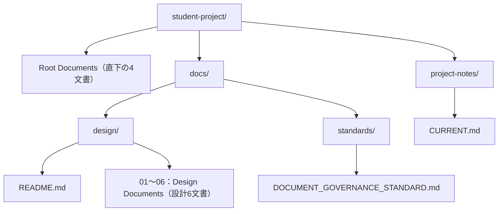

<!--
Program Name: DDT Governed Development Guide
Language: Markdown
Function: 今期対象外の管理ルール導入・学習用途の説明を講師用に分離する
Created: 2026-10-09
Last Updated: 2026-10-09
Author: Takashi Oikawa
AI: Cursor
Memo: Document ID DDT-GOVERNED-GUIDE-001。Version 0.1 / Draft。正式承認ではない
-->

# Governed Development Guide（講師用・管理ルール導入参考）

<!-- Document Info（文書情報） -->
| Item（項目） | Value（値） |
|---|---|
| Document ID（文書ID） | DDT-GOVERNED-GUIDE-001 |
| Version（バージョン） | 0.1 |
| Status（ステータス） | Draft |
| Created Date（作成日） | 2026-10-09 |
| Last Updated（最終更新日） | 2026-10-09 |
| Owner（管理者） | Takashi Oikawa |
| Related Documents（関連文書） | [生徒向け使用説明書](./STUDENT_USAGE_GUIDE.md) / [AGENTS.md](../AGENTS.md) / [CONSTITUTION.md](../CONSTITUTION.md) / [CURRENT.md](../project-notes/CURRENT.md) / [CHANGELOG.md](../CHANGELOG.md) |

## 1. 対象と提供条件

今期は手順Aのみを提供する。本書は講師用の将来の検討資料（Draft）であり、手順B・LEARNINGの提供開始や管理ルール導入の完了を示さない。

手順Bは、講師が管理文書・検証資産の取得経路と承認権限を確定し、導入を確認してから案内する。生徒であることを理由にPurposeをLEARNINGと推測しない。Purposeは権限を持つ人が明示的に確定する。

中央管理コピーを生徒用にローカルで書き換えない。CONSTITUTION・AGENTSにあるPurpose確定者の記述や、Cursor等の自動読み込みの挙動は、提供前に別途確認する。今期の手順Aの完了条件には含めない。

以下は既存説明の移管であり、新しいinstaller、導入経路、AI制御仕様を追加するものではない。ここに示す読み順は、導入時点のAGENTSを正として再確認する。

## 2. 管理文書と配置

### 2.1 管理5文書

次の5文書は、次の役割を持ちます。Bでは、原則として**自分のプロジェクトに配置された文書**をAIに読ませます。

| File（ファイル） | Role（役割） | When to Read（読む場面） | Handling（扱い） |
|---|---|---|---|
| `CONSTITUTION.md` | 全体の約束。誰が決め、AIがどこまで作業できるか、何を確認して完了とするかを定める | Bの開始時・再開時にAIが読む。人も承認と作業範囲のルールを確認する | 中央管理コピー。自分のプロジェクト用に独自編集しない |
| `AGENTS.md` | AIの作業手順。読む文書の順序、現在地点の確認、矛盾があるときの対応などを定める | BでAIが最初に読む。新しいAIや会話へ切り替えたときも読む | 中央管理コピー。AIの人格設定を書く場所ではない |
| `CHANGELOG.md` | 自分のプロジェクトで実際に行った変更の履歴 | 文書・実装の変更前に関連履歴を確認し、変更後に実施内容を記録する | 自分の履歴として管理する。配布元の履歴を持ち込まない。LEARNINGでは必須ではない |
| `docs/standards/DOCUMENT_GOVERNANCE_STANDARD.md` | Markdown文書の共通ヘッダー項目、表記、文書検査のルール | 管理文書を新規作成・編集するとき、検査結果を確認するときに参照する | 配布コピーを独自編集しない。設計書の内容や版数の全ルールを、この文書だけで判断しない |
| `docs/NEW_REPOSITORY_SETUP_GUIDE.md` | 新しいリポジトリを作り、管理ルールを初期配置する手順 | 新規作成時に講師と確認する | 日常のAI利用手順とは別。既存リポジトリへの移行手順ではない。非公開の配布元を使う部分は講師が準備する |

`CONSTITUTION.md`、`AGENTS.md`、文書標準は「作業のルール」、`CHANGELOG.md` は「実施したことの履歴」、新規作成ガイドは「環境を準備する手順」です。

### 2.2 プロジェクトの入口と現在地点

AIが作業を再開するためには、次の文書も使います。

| File（ファイル） | Role（役割） | What to Record（記録する内容） |
|---|---|---|
| 自分のルート `README.md` | プロジェクトの入口 | 何を作るか、目的、使い方、関連文書への案内 |
| 自分の `project-notes/CURRENT.md` | 作業の現在地点 | Purpose、確認できた完了項目、現在の作業、次の作業、阻害要因 |
| 自分の `project-notes/DECISIONS.md`（必要な場合） | 継続して管理する判断の記録 | 判断内容と理由。関連Decisionを指定された場合などに読む |

`CURRENT.md` は「次のAIに渡す引き継ぎメモ」と考えてください。配布元の `CURRENT.md` は配布リポジトリの状態を表します。自分の課題の現在地点としてコピーしてはいけません。

`CURRENT.md` は標準の運用文書ですが、必須Governance文書10件には加えません。不在や初期の未記入だけで、Gitとの矛盾と判定しません。実際に書かれた状態がGitの実状態と食い違う場合は、編集を止めて確認します。

次はBを使う場合の主要な構成です。末尾が `/` の枠はフォルダです。直下の4文書と設計6文書は、図を読みやすくするため、それぞれ1枠にまとめています。



`student-project` は説明用の名前です。自分のリポジトリ名へ読み替えます。コード、テスト、画像、検証資産の配置は次の表でも確認します。

| Path（パス） | Content（内容） | Requirement（扱い） |
|---|---|---|
| `/README.md` | 自分のプロジェクトの入口 | Aでは課題説明などと合わせて用意。Bの新規作成手順、LEARNINGでも使用する |
| `/CONSTITUTION.md` | 講師が導入した管理ルール | B・LEARNINGの必須文書 |
| `/AGENTS.md` | 講師が導入したAIの作業手順 | B・LEARNINGの必須文書 |
| `/CHANGELOG.md` | 自分の変更履歴 | Bの必須文書。LEARNINGでは必須ではない |
| `/docs/design/README.md` と01〜06 | 自分の設計書7文書 | Aの演習対象、Bの必須文書。LEARNINGでは必須ではない |
| `/docs/standards/DOCUMENT_GOVERNANCE_STANDARD.md` | 文書作成時の参照用コピー | 講師が指定した標準の配置に従う。必須Governance文書10件とは別 |
| `/project-notes/CURRENT.md` | 自分の現在地点 | 標準の運用文書 |
| `/project-notes/DECISIONS.md` | 判断の記録 | 必要な場合。存在するものを不要と判断して削除しない |
| `/scripts/validate-docs.py` | Markdown文書検査 | Bの必須検証資産。LEARNINGでは必須ではない |
| `/.github/workflows/validate-docs.yml` | GitHub上で文書検査を実行する設定 | Bの必須検証資産。LEARNINGでは必須ではない |
| `/docs/design/screenshots/thumbnail/` | 設計書README用の小さい代表画像 | 画像を使用する場合 |
| `/docs/design/screenshots/full/` | 04で説明する詳細画像 | 画像を使用する場合 |
| コード・テストのフォルダ | 実装と検証のファイル | 自分の設計と作業指示で指定した配置を使う |

Aでは設計7文書の配置が中心です。この図の管理文書や検証資産を、配布元から独自判断で追加する必要はありません。

ルートの `README.md` と `docs/design/README.md` は別のファイルです。前者はプロジェクト全体の入口、後者は設計書群の入口です。

管理文書10件の内訳は、ルートのCONSTITUTION・AGENTS・CHANGELOGの3文書と、`docs/design/` の設計7文書である。標準Profileの検証資産は `scripts/validate-docs.py` と `.github/workflows/validate-docs.yml` の2件。ルートREADME、CURRENT、文書標準の参照用コピーとは区別する。LEARNINGの条件は§4を参照する。

## 3. 手順Bの読み込み

自分の `AGENTS.md` の読み順を正とします。現行文書では、最初にAGENTSの手順を確認し、`CURRENT.md` がある場合は、Profile別の必須読み順より先に読みます。

| Step（順序） | File or Evidence（文書・確認資料） | Purpose（読む目的） |
|---|---|---|
| 入口 | `/AGENTS.md` | 作業手順と適用Profileを確認する |
| 事前確認 | `/project-notes/CURRENT.md`（存在する場合）とGit実状態 | 今どこまで進んでいるか、実状態と記録が食い違わないか確認する |
| 1 | `/CONSTITUTION.md` | 権限、変更範囲、確認・承認のルールを確認する |
| 2 | `/docs/design/README.md` | プロジェクトと設計全体を把握する |
| 3 | `/docs/design/01_REQUEST_DEFINITION.md` | 背景・要求・成功条件を把握する |
| 4 | `/docs/design/02_REQUIREMENTS_DEFINITION.md` | 必要な機能と条件を把握する |
| 5 | `/docs/design/03_DATA_AND_SECURITY_DESIGN.md` | データ・権限・セキュリティを把握する |
| 6 | `/docs/design/04_UI_AND_FLOW_DESIGN.md` | 画面と操作を把握する |
| 7 | `/docs/design/05_ARCHITECTURE_DESIGN.md` | 構成と技術方針を把握する |
| 8 | `/docs/design/06_OPERATION_AND_HANDOFF.md` | 確認・運用・引き継ぎ方針を把握する |
| 9 | 今回の対象機能の仕様正本（指定されている場合） | どの機能仕様に従うか確認する |
| 10 | 承認済み作業指示書 | 今回の変更対象・作業・確認方法を確認する |
| 11 | 関連コード | 実装の実態を確認する |
| 12 | 関連テスト | 何を検証できるか確認する |

Git実状態は、作業できる環境のAIがリポジトリルート、ブランチ、HEAD、remoteの状態、未コミット差分、最新コミットなどを確認します。ブラウザAIがGitを直接確認できない場合は、Cursorなどが取得した確認記録を渡します。記録がなければ、確認済みとは扱いません。

変更前には、対象文書のVersion・Last Updated・Git履歴・CHANGELOGも確認します。ルートREADMEはプロジェクトの入口として、本書と文書標準は利用・編集時の参考として参照します。

`DECISIONS.md` は毎回全文を必須にせず、CURRENTや作業指示が指定する判断、構成・運用・配布を変更する場合など、関連する範囲を読みます。

新規設計の相談段階で、機能別仕様、承認済み実装指示、コード、テストがまだ存在しない場合は、その状態を明記します。存在しないものを読んだと報告したり、実装指示を自動的に承認済みにしたりしません。実装を始める前には、その作業に必要な仕様と指示を揃えます。

## 4. LEARNINGの読み込み

講師がPurposeを `LEARNING` と確定した場合は、AGENTSを確認し、CURRENTがあれば先に読んだ後、次を読みます。

1. 自分の `CONSTITUTION.md`
2. 自分のルート `README.md`
3. 関連する `DECISIONS.md`（必要な場合）
4. 今回の対象教材

LEARNINGでは、設計7文書、CHANGELOG、文書検査用スクリプト・workflowを一律の必須条件にしません。設計書を教材として使う場合は、課題が指定した文書を対象教材として追加します。

## 5. AIの役割と開始指示

| Role（役割） | Additional Inputs（共通文書に加えて渡すもの） | Expected Output（求める結果） |
|---|---|---|
| Design Assistant（設計を相談するAI） | 課題文、利用者の希望、制約、今回決めたいこと | 要求の整理、設計案、確認が必要な質問、実装担当へ渡す指示案 |
| Implementation Assistant（実装するAI） | 承認済みの具体的な作業指示、変更可能なファイル、確認方法 | 指定範囲の変更、実差分、検証結果、残っている問題 |
| Review Assistant（確認するAI） | 変更後の実ファイル、実差分、判断基準となる仕様、検証結果 | 仕様との一致、不足・矛盾、修正が必要な箇所 |

同じAIを使う場合も、今回の役割を指定します。実装AIの「完了」という文章だけを別のAIへ渡して、レビュー完了と判断しません。

この指示文は、講師が管理ルールの導入を確認した、LEARNING以外の現行Profileに使います。LEARNINGでは§4の読み込み対象へ切り替えます。

```text
次の私のプロジェクトを対象に、今回の作業の準備をしてください。

Repository（対象）：<自分のリポジトリURLまたは名前>
Local Directory（ローカル保存先）：<自分の保存先。ブラウザAIでは未接続と明記>
Purpose（講師が確認した値）：<確認済みの値>
Role（今回の役割）：<設計相談／実装／レビュー>
Task（今回の依頼）：<具体的な依頼>

最初に、このプロジェクトのAGENTS.mdを読んでください。
project-notes/CURRENT.mdがあれば、必須文書の読み順より先に読み、
Git実状態または提供された最新の確認記録と照合してください。

その後、AGENTS.mdの順序に従い、次を読んでください。
- CONSTITUTION.md
- docs/design/README.md
- docs/design/01_REQUEST_DEFINITION.md
- docs/design/02_REQUIREMENTS_DEFINITION.md
- docs/design/03_DATA_AND_SECURITY_DESIGN.md
- docs/design/04_UI_AND_FLOW_DESIGN.md
- docs/design/05_ARCHITECTURE_DESIGN.md
- docs/design/06_OPERATION_AND_HANDOFF.md
- 対象機能の仕様正本：<指定されたパス／相談段階で未作成>
- 承認済み作業指示書：<指定された資料／相談段階で未作成>
- 関連コード・テスト：<対象パス／未実装>

編集前には関連するCHANGELOG、文書の版・更新日・Git履歴を確認し、
必要な文書標準、ルートREADME、関連Decisionも参照してください。

読めた文書のパスと版数、読めなかった文書、適用するPurpose、
今回の対象範囲を簡潔に示してください。
Gitを確認できない場合は未確認と明記してください。
この依頼は準備と確認です。ここでは編集、commit、pushは行いません。
```

### 5.1 読み込み確認

AIの読み込み確認は、次のような情報があれば確認できます。実際の値を記載させます。

| Item（項目） | Expected Information（確認する情報） |
|---|---|
| Target Repository（対象リポジトリ） | 自分のプロジェクト名・ルート |
| Purpose（目的） | 人が確認した値。AIの推測ではない |
| Read Documents（読んだ文書） | パス、Document IDとVersion、標準文書ではSTANDARD_VERSIONなど |
| Unread Documents（読めなかった文書） | パスと理由。未作成と取得失敗を区別する |
| Current State（現在地点） | 今回扱う作業と次の作業。Git確認の有無も区別する |
| Work Scope（作業範囲） | 今回変更できるものと、まだ承認されていないもの |

## 6. 実装・レビュー・引き継ぎ

設計を決める段階と実装する段階を区別する。既存の仕様ID管理に従い、実装AIへ新規採番や確定仕様の独自変更をさせない。

### 6.1 実装を依頼する

実装を依頼するときは、少なくとも次を具体的にします。

- 基準とする設計・機能仕様と、その版。
- 今回実装することと、変更するファイル。
- 変更範囲の承認者と、承認済みの作業指示。
- 合否を判断する確認方法。
- 実差分と確認結果の提出方法。

「設計書を読んで、よい感じに作って」だけでは作業範囲が決まりません。AIが必要な追加変更を見つけた場合は、承認済みの範囲へ勝手に加えず、候補として報告させます。

### 6.2 結果を確認する

変更後の実ファイルと差分を使い、仕様との一致を確認します。未追跡の新規ファイルは通常の `git diff` に本文が含まれないため、全文も提出対象にします。

確認担当へは「作業報告」だけでなく、変更した文書・コード、実差分、確認コマンドの結果、未実施の確認、残っている問題を渡します。Bでは設計担当の差分レビューを経て、明示指示の範囲でcommit・pushなどを行います。

### 6.3 作業終了時の記録

CURRENTを運用している場合は、実際に確認したことを記録します。

| Field（項目） | Content（記録内容） |
|---|---|
| Purpose（目的） | 人が確定したRepository Purpose |
| Completed（完了） | 実施・確認できたこと。確認資料や結果も必要に応じて記載する |
| Current（現在） | 現在進めている作業・確認段階 |
| Next（次） | 次に着手する具体的な作業 |
| Blockers（阻害要因） | 作業を妨げている未解消の問題 |
| Related Decisions（関連Decision） | 関係する既存の判断記録。存在しない番号は作らない |

CHANGELOGを使うプロジェクトでは、実施した変更を履歴へ記録します。「案を作った」「レビュー済み」「commit済み」「push済み」「公開済み」はそれぞれ別の状態です。予定を完了欄に書きません。

### 6.4 再開の指示文

```text
このプロジェクトの作業を再開します。
今回の対象：<自分のリポジトリ>
今回の役割：<設計相談／実装／レビュー>
今回の依頼：<具体的な依頼>

前の会話だけを基準にせず、最新の文書を読み直してください。
管理ルールを導入したプロジェクトでは、AGENTS.mdの手順に従い、
CURRENT.mdがあれば先に読んで実状態と照合し、
確定したPurposeの必須文書・今回の関連資料を確認してください。

添付または参照資料：
- 最新の管理ルールと設計文書・課題文
- CURRENT.md（使用している場合）
- 今回の作業指示・機能仕様
- 作業中の差分と変更後ファイル（ある場合）
- 最新のGit確認・検証結果（別の環境から引き継ぐ場合）

何を確認できたか、何が未確認かを区別して、今回の開始地点を示してください。
```

## 7. 検証

Bでは、講師が導入した検証資産がある環境で、文書変更後にリポジトリルートから確認します。

```bash
python3 scripts/validate-docs.py
git diff --check
git status --short
```

| Check（確認） | What It Shows（分かること） | Additional Review（別に確認すること） |
|---|---|---|
| `validate-docs.py` | 検査対象Markdownに必須ヘッダーの項目名があるか | 項目の値、設計の正しさ、リンク、版数の一致、承認実績 |
| `git diff --check` | 差分に含まれる空白などの問題 | 仕様と実装の一致、機能の動作 |
| `git status --short` | 変更・追加されたファイル | 各ファイルの内容と、今回の作業範囲に収まるか |

検査がPASSでも、内容のレビューや承認が済んだことにはなりません。LEARNINGではvalidatorとworkflowは必須ではなく、不在だけを理由に作業を止めません。

画像・リンク・設計書一覧の整合、課題の条件、機能の受け入れ基準などは、内容を見て確認します。
