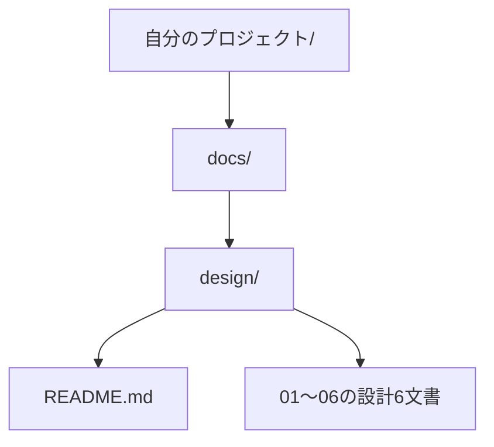

<!--
Program Name: DDT Student Usage Guide
Language: Markdown
Function: 設計テンプレートの取得、初期化、AIとの設計書作成を案内する
Created: 2026-10-09
Last Updated: 2026-10-09
Author: Takashi Oikawa
AI: Cursor
Memo: Document ID DDT-STUDENT-GUIDE-001。Version 0.3 / Draft。正式承認ではない
-->

# Student Usage Guide（生徒向け使用説明書）

<!-- Document Info（文書情報） -->
| Item（項目） | Value（値） |
|---|---|
| Document ID（文書ID） | DDT-STUDENT-GUIDE-001 |
| Version（バージョン） | 0.3 |
| Status（ステータス） | Draft |
| Created Date（作成日） | 2026-10-09 |
| Last Updated（最終更新日） | 2026-10-09 |
| Owner（管理者） | Takashi Oikawa |
| Related Documents（関連文書） | [README.md](../README.md) / [設計テンプレート一覧](../templates/design/README.md) / [CHANGELOG.md](../CHANGELOG.md) |

## 1. このガイドでできること

設計書は、作るものの目的・機能・構成・確認方法を整理する文書です。このガイドでは、7文書のテンプレートを取得し、自分のプロジェクトに配置して、AIと相談しながら記入します。今期は設計書の演習（手順A）を行います。

流れは「取得 → 配置 → 自分の文書として初期化 → AIと記入 → 内容を確認」です。課題文と講師の指示を手元に用意してください。

手順B・LEARNINGは今期の対象外です。[管理ルールを導入した開発の講師用参考資料](./GOVERNED_DEVELOPMENT_GUIDE.md)に分けています。

## 2. 用語ミニ辞典

説明書とテンプレートで使う用語です。使う場面で参照してください。

| 用語 | 意味 |
|---|---|
| リポジトリ（Repository） | プロジェクトのファイルと変更履歴を管理する場所。 |
| ルート（Root） | プロジェクトの最上位のフォルダ。 |
| ディレクトリ（Directory） | フォルダ。`docs/design/` は `docs` の中の `design` フォルダ。 |
| テンプレート（Template） | 自分のプロジェクトに合わせて記入する文書の枠組み。 |
| 正本文書 | そのプロジェクトで、最新の基準として管理する文書。 |
| Markdown | 見出し・表・リンクなどを、記号と文章で書く形式。 |
| 相対リンク | 文書の場所を基準に、別のファイルを指定するリンク。 |
| 文書ID（Document ID） | 文書を識別する名前。文書の版数とは別。 |
| Owner | 文書を管理する担当者。自分の設計書では自分の名前を記入する。 |
| Version | 文書の版数。更新した文書を区別するための番号。 |
| Draft / Approved | 草稿 / 承認済み。AIが案を作っただけでは承認済みにならない。 |
| Purpose | 目的。管理ルールで使うRepository Purposeは、人が確定するリポジトリの用途。 |
| Profile | 確定した用途に応じて、必要な文書や手順を選ぶ管理ルールの区分。 |
| 管理ルール（Governance） | 作業範囲・承認・確認・記録などの約束。 |
| 中央管理コピー | 共通ルールの原本から配布された文書。設計書の記入用テンプレートとは扱いが異なる。 |
| Git | ファイルの変更履歴を管理する仕組み。 |
| commit | 変更を、自分のGitの履歴に記録する操作。 |
| push | 自分のGitの履歴を、GitHubなどの共有先へ送る操作。 |
| HEAD | Gitで、現在の作業の基点となるコミットを指す名前。 |
| 要求 / 要件 | 利用者が望むこと / それを実現するためにシステムが満たす条件。 |
| 成功基準 | 目的を達成したと判断するための条件。 |
| シナリオ | 利用者が目的を達成するまでの操作の流れ。 |
| 非機能要件 | 機能以外の条件。性能・安全性・使いやすさなど。 |
| UI | 利用者が見る画面や操作する部分。 |
| API | ソフトウェア同士がデータや処理をやり取りするための窓口。 |
| DB / エンティティ | データベース / データとして管理する対象。例：利用者・予約。 |
| ER図 | データとして管理する対象と、それらの関係を示す図。 |
| PK / FK | データを一意に識別するキー / 別のテーブルのデータを参照するキー。 |
| 認証 / 認可 | 本人か確かめること / 許可する操作やデータを決めること。 |
| バリデーション | 入力内容が条件を満たすか確認すること。 |
| 可用性 | 必要なときにシステムを利用できる性質。 |
| フェイルオーバー | 障害時に、予備のシステムへ処理を切り替えること。 |
| ステージング | 本番公開前に、動作を確認するための環境。Gitのステージングは、次のcommitに含める変更を選ぶ操作。 |
| 受け入れ基準 | 成果物を受け入れてよいか判断する条件。 |
| エスカレーション | 自分では解決できない問題を、判断できる担当者へ引き継ぐこと。 |
| Mermaid | 文字で書いた記述から、構成図や流れの図を表示する仕組み。 |

## 3. 7文書の役割

| ファイル | 文書ID | 答える問い | 記載例 |
|---|---|---|---|
| `README.md`（設計書フォルダ内） | `README-001` | 全体として何を作るか | 概要・設計書一覧・全体方針。詳細は個別文書へ案内。 |
| `01_REQUEST_DEFINITION.md` | `REQ-001` | なぜ、誰のために作るか | 背景・課題・利用者の要求・制約・成功条件。 |
| `02_REQUIREMENTS_DEFINITION.md` | `REQS-001` | システムは何を満たすか | 機能・性能などの条件・要求との対応。 |
| `03_DATA_AND_SECURITY_DESIGN.md` | `DATA-001` | データを誰がどう扱うか | データの関係・保存方法・権限・安全性。 |
| `04_UI_AND_FLOW_DESIGN.md` | `UI-001` | どの画面でどう操作するか | 画面項目・画面遷移・入力確認・操作の流れ。 |
| `05_ARCHITECTURE_DESIGN.md` | `ARCH-001` | どの構成で実現するか | 構成図・採用技術と理由・API・環境・障害対策。 |
| `06_OPERATION_AND_HANDOFF.md` | `OPS-001` | どう確認して引き継ぐか | テスト方針・受け入れ基準・公開や障害対応の方針。 |

例えば「ログインした利用者だけが自分の記録を見られる」という条件は02、権限や保存方法は03、画面と操作は04、構成とAPIは05、確認するテストは06へ書きます。同じ条件を別々に決め直さず、参照関係を保ちます。

01で目的、02で必要な機能、03〜05で具体的な設計、06で確認・引き継ぎ方法を整理します。設計書READMEの一覧も、記入に合わせて更新します。

## 4. 取得と配置

講師が案内した配布版から、次の7文書をセットで取得します。

| 配布元のファイル | 自分のプロジェクトの保存先 |
|---|---|
| `templates/design/README.md` | `docs/design/README.md` |
| `templates/design/01_REQUEST_DEFINITION.md` | `docs/design/01_REQUEST_DEFINITION.md` |
| `templates/design/02_REQUIREMENTS_DEFINITION.md` | `docs/design/02_REQUIREMENTS_DEFINITION.md` |
| `templates/design/03_DATA_AND_SECURITY_DESIGN.md` | `docs/design/03_DATA_AND_SECURITY_DESIGN.md` |
| `templates/design/04_UI_AND_FLOW_DESIGN.md` | `docs/design/04_UI_AND_FLOW_DESIGN.md` |
| `templates/design/05_ARCHITECTURE_DESIGN.md` | `docs/design/05_ARCHITECTURE_DESIGN.md` |
| `templates/design/06_OPERATION_AND_HANDOFF.md` | `docs/design/06_OPERATION_AND_HANDOFF.md` |



この図は設計書の配置を示します。プロジェクト全体の入口となるルートREADMEと、設計書フォルダのREADMEは別のファイルです。

保存先に記入済みの文書がある場合は上書きせず、講師へ確認してください。配布元の `docs/design/` は配布リポジトリ自体の設計です。自分の設計書としてコピーしません。

## 5. 自分の文書にする

7文書の冒頭にある文書情報を、次の値で初期化します。

| 項目 | 初期値 |
|---|---|
| Document ID（文書ID） | テンプレートの既存IDを維持する。対応は§3の表。 |
| Owner（管理者） | 自分（生徒）の名前。 |
| Created Date（作成日） | 自分の文書として初期化した日。`YYYY-MM-DD` 形式。 |
| Last Updated（最終更新日） | 初期化した日。その後は実際に更新した日。 |
| Version（バージョン） | `0.1`。配布テンプレートの版数とは別に、自分の初版を開始する。 |
| Status（ステータス） | `Draft`。 |

設計書READMEの一覧も、個別文書のVersion・Status・Ownerに合わせます。`（記入欄）` を自分の情報へ置き換え、未決の内容は「未決」と分かるように残します。

`0.x` は草稿、`1.0` は初回承認版です。承認は講師が示した方法で受けます。AIが記入しただけで `Approved` にしたり、設計演習の依頼からコード実装へ進めたりしません。

リンクと画像も自分の内容に合わせます。テンプレートの `../../CHANGELOG.md` は、自分のプロジェクトの変更履歴へのリンクです。履歴文書を使わない課題では、自分のコピーの該当箇所に「この課題では履歴文書を使用しない」と記載し、存在しないリンクを残しません。配布元の履歴を自分の履歴として代用しません。

画像パスは記入例です。自分の画像を用意して参照先を直すか、使わない場合は該当しない理由を記載します。代表画像は `docs/design/screenshots/thumbnail/`、詳細画像は `docs/design/screenshots/full/` が配置例です。リンク先を実際に開き、図が表示されるか確認してください。

これらは自分の `docs/design/` の記入です。配布元のテンプレートを修正する作業とは異なります。

## 6. AIと一緒に書く

### 6.1 実際に読める形で渡す

| AIの環境 | 渡すもの・確認すること |
|---|---|
| ブラウザの対話AI | 課題文、講師の指示、自分の最新の7文書を添付する。読めたファイルと版数、読めなかったものを回答させる。 |
| Cursorなどの編集環境 | 自分のプロジェクトを開き、読む相対パスを指定する。別のプロジェクトを読んでいないか確認する。 |
| 別のAIや新しい会話 | 最新ファイル、決めた内容、未決の内容、今回の依頼を渡す。以前の会話の記憶だけに頼らない。 |

URLやファイル名だけでは、本文を読んだことになりません。取得できない資料は添付するなど、実際に読める形で渡します。添付数に制限がある場合は分割し、必要な資料が読めたことを確認してから相談します。

### 6.2 最初の指示文

`<...>` を自分の情報へ置き換えて使います。

```text
私は授業で、自分のプロジェクトの設計書を作成します。
今回の役割は設計相談です。
プロジェクト名：<自分のプロジェクト名>
課題：<課題文または添付名>
今回の目的：<例：01の背景・課題・成功条件を整理する>

次の自分の最新資料を読んでください。
- 課題文・講師の指示
- ルートREADME.md（用意している場合）
- docs/design/README.md と01〜06の設計6文書

読めたファイルと版数、読めなかったものを示してください。
未記入のテンプレート、私が決めた内容、提案、未決の内容を区別してください。
利用者・機能・期限・技術・承認実績を推測で埋めないでください。
まず必要な確認を行い、指定した節の記入案を提示してください。
ファイルの直接編集やコード実装は、この依頼には含めません。
```

### 6.3 節ごとの依頼と確認

```text
今回の対象は docs/design/01_REQUEST_DEFINITION.md の5.1と5.5です。
課題文と私の説明から、背景・課題・成功条件の案を作ってください。
不明なことは質問し、ほかの文書への影響は変更候補として示してください。
```

案を読んで、自分の考えや課題の条件に合うか確認します。決めた内容だけを自分の文書へ反映します。節が課題に該当しない場合は、削除する前に講師へ確認し、対象外とする理由を記載してください。

最後に、01の成功条件、02の要件、03〜05の設計、06の確認方法がつながっているか確認します。次回のために、決めたこと・未決のこと・次に相談する節をメモしておきます。

## 7. よくある質問

| 質問 | 回答 |
|---|---|
| 7文書を置けば、AIの管理ルールも導入されますか。 | 設計書の配置と、AIの管理ルールの導入は別です。今期は、このガイドの設計演習を行います。 |
| AIはファイルを自動で読みますか。 | 読むファイルを指定し、読めたものと読めなかったものを確認します。 |
| 未決の内容も埋める必要がありますか。 | 決定済みにせず、未決の内容と確認が必要なことを残します。 |
| 新しいテンプレートが出たら、自分の設計書を置き換えますか。 | 上書きしません。変更点を確認し、必要な内容だけを自分の文書へ反映します。 |
| テンプレートの一覧やIDが合わない場合はどうしますか。 | 旧配布版には、一覧の版数と各文書の版数の相違、目次第2項目のリンク不一致、成功基準とシナリオの例示IDの重複があります。講師へ使用版を確認し、修正版の案内に従ってください。これらは自分の設計内容の誤りではありません。 |
