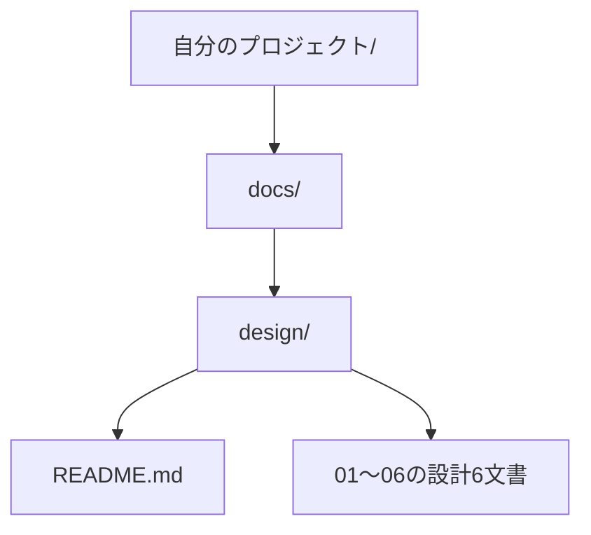

<!--
Program Name: DDT Student Usage Guide
Language: Markdown
Function: 設計テンプレートの取得、初期化、仕様に従った記入と実装を案内する
Created: 2026-10-09
Last Updated: 2026-10-10
Author: Takashi Oikawa
AI: Cursor
Memo: Document ID DDT-STUDENT-GUIDE-001。Version 0.4 / Draft。正式承認ではない
-->

# Student Usage Guide（生徒向け使用説明書）

<!-- Document Info（文書情報） -->
| Item（項目） | Value（値） |
|---|---|
| Document ID（文書ID） | DDT-STUDENT-GUIDE-001 |
| Version（バージョン） | 0.4 |
| Status（ステータス） | Draft |
| Created Date（作成日） | 2026-10-09 |
| Last Updated（最終更新日） | 2026-10-10 |
| Owner（管理者） | Takashi Oikawa |
| Related Documents（関連文書） | [README.md](../README.md) / [設計テンプレート一覧](../templates/design/README.md) / [7文書管理と設定ファイルの参考資料](./GOVERNED_DEVELOPMENT_GUIDE.md) / [CHANGELOG.md](../CHANGELOG.md) |

## 1. このガイドでできること

> SDD（仕様駆動開発）で、AIが作成する設計文書を決まった7文書・決まった節へ収め、重複と冗長化を防ぐためのテンプレートを配布する。生徒は自分のリポジトリに配置して使う。

SDDは、仕様書を先に書き、AIはその仕様に従って実装する進め方です。設計内容と承認は、そのリポジトリの持ち主が判断します。AIは未決事項や承認実績を推測しません。

流れは「取得 → 配置 → 自分の文書として初期化 → 記入と確認 → 仕様変更と実装」です。基本構成は `docs/design/README.md` と 01〜06 の7文書です。AGENTS.md と CONSTITUTION.md は利用先で任意であり、両方なくても記入、仕様変更、実装、確認を進められます。

7文書を置いただけでは効果は保証されません。記載する節を指定し、同じ内容は再掲せず正本を参照し（SSOT）、人が内容を確認します。設定ファイルが既にある場合は、その現行ルールを読みます。設定を削除したり無視したりして、別の運用へ移す案内はしません。

特定の提供区分には依存しません。配布元自身の管理ルールと、利用先で設定が任意であることは別です。設定を任意で導入する手順は [7文書管理と設定ファイルの参考資料](./GOVERNED_DEVELOPMENT_GUIDE.md) を参照してください。

## 2. 用語ミニ辞典

説明書とテンプレートで使う用語です。使う場面で参照してください。

| 用語 | 意味 |
|---|---|
| SDD（仕様駆動開発） | 仕様書を先に書き、AIはその仕様に従って実装する進め方。 |
| SSOT | 正しい情報の管理元を一つに定める原則。同じ内容は再掲せず、正本を参照する。 |
| リポジトリ | プロジェクトのファイルと変更履歴を管理する場所。 |
| ルート | プロジェクトの最上位のフォルダ。 |
| テンプレート | 自分のプロジェクトに合わせて記入する文書の枠組み。 |
| 正本 | その内容を決める基準となる文書・節。他の箇所は正本を参照する。 |
| Markdown | 見出し・表・リンクなどを、記号と文章で書く形式。文書はこの形式で書く。 |
| 相対リンク | 文書の場所を基準に、別のファイルを指定するリンク。 |
| 文書ID（Document ID） | 文書を識別する名前。文書の版数とは別。 |
| Owner | 文書を管理する担当者。自分の設計書では自分の名前を記入する。 |
| Version | 文書の版数。更新した文書を区別するための番号。 |
| Draft / Approved | 草稿 / 承認済み。AIが案を作っただけでは承認済みにならない。 |
| Purpose | 目的。文書が何を定義するか。 |
| 要求 / 要件 | 利用者が望むこと / それを実現するためにシステムが満たす条件。 |
| 成功基準 | 目的を達成したと判断するための条件。 |
| シナリオ | 利用者が目的を達成するまでの操作の流れ。 |
| 非機能要件 | 機能以外の条件。性能・安全性・使いやすさなど。 |
| UI | 利用者が見る画面や操作する部分。 |
| API | ソフトウェア同士がデータや処理をやり取りするための窓口。 |
| DB / エンティティ | データベース / データとして管理する対象。例：利用者・予約。 |
| ER図 | データとして管理する対象と、それらの関係を示す図。 |
| PK / FK | データを一意に識別するキー / 別のテーブルのデータを参照するキー。 |
| 認証 / 認可 | 本人か確かめること / 許可する操作やデータを決めること。 |
| バリデーション | 入力内容が条件を満たすか確認すること。 |
| 可用性 | 必要なときにシステムを利用できる性質。 |
| フェイルオーバー | 障害時に、予備のシステムへ処理を切り替えること。 |
| ステージング | 本番公開前に、動作を確認するための環境。 |
| 受け入れ基準 | 成果物を受け入れてよいか判断する条件。 |
| エスカレーション | 自分では解決できない問題を、判断できる担当者へ引き継ぐこと。 |
| Mermaid | 文字で書いた記述から、構成図や流れの図を表示する仕組み。 |

## 3. 7文書の役割

| ファイル | 文書ID | 答える問い | 記載例 |
|---|---|---|---|
| `README.md`（設計書フォルダ内） | `README-001` | 全体として何を作るか | 概要・設計書一覧・全体方針。詳細は個別文書へ案内。 |
| `01_REQUEST_DEFINITION.md` | `REQ-001` | なぜ、誰のために作るか | 背景・要求・利用者の要求・制約・成功条件。 |
| `02_REQUIREMENTS_DEFINITION.md` | `REQS-001` | システムは何を満たすか | 機能・性能などの条件・要求との対応。 |
| `03_DATA_AND_SECURITY_DESIGN.md` | `DATA-001` | データを誰がどう扱うか | データの関係・保存方法・権限・安全性。 |
| `04_UI_AND_FLOW_DESIGN.md` | `UI-001` | どの画面でどう操作するか | 画面項目・画面遷移・入力確認・操作の流れ。 |
| `05_ARCHITECTURE_DESIGN.md` | `ARCH-001` | どの構成で実現するか | 構成図・採用技術と理由・API・環境・障害対策。 |
| `06_OPERATION_AND_HANDOFF.md` | `OPS-001` | どう確認して引き継ぐか | テスト方針・受け入れ基準・公開や障害対応の方針。 |

例えば「ログインした利用者だけが自分の記録を見られる」という条件は02、権限や保存方法は03、画面と操作は04、構成とAPIは05、確認するテストは06へ書きます。同じ条件を別々に決め直さず、正本の節を参照します。

01で目的、02で必要な機能、03〜05で具体的な設計、06で確認・引き継ぎ方法を整理します。設計書READMEの一覧も、記入に合わせて更新します。

## 4. 取得と配置

取得元は `templates/design/` です。次の7文書をセットで取得し、自分のプロジェクトの `docs/design/` へ置きます。配布元の `docs/design/` は配布リポジトリ自体の設計です。自分の設計書としてコピーしません。

| 配布元のファイル | 自分のプロジェクトの保存先 |
|---|---|
| `templates/design/README.md` | `docs/design/README.md` |
| `templates/design/01_REQUEST_DEFINITION.md` | `docs/design/01_REQUEST_DEFINITION.md` |
| `templates/design/02_REQUIREMENTS_DEFINITION.md` | `docs/design/02_REQUIREMENTS_DEFINITION.md` |
| `templates/design/03_DATA_AND_SECURITY_DESIGN.md` | `docs/design/03_DATA_AND_SECURITY_DESIGN.md` |
| `templates/design/04_UI_AND_FLOW_DESIGN.md` | `docs/design/04_UI_AND_FLOW_DESIGN.md` |
| `templates/design/05_ARCHITECTURE_DESIGN.md` | `docs/design/05_ARCHITECTURE_DESIGN.md` |
| `templates/design/06_OPERATION_AND_HANDOFF.md` | `docs/design/06_OPERATION_AND_HANDOFF.md` |



この図は設計書の配置を示します。プロジェクト全体の入口となるルートREADMEと、設計書フォルダのREADMEは別のファイルです。

保存先に記入済みの文書がある場合は上書きしません。差分を確認し、必要な内容だけを持ち主が反映します。

## 5. 自分の文書にする

7文書の冒頭にある文書情報を、次の値で初期化します。

| 項目 | 初期値 |
|---|---|
| Document ID（文書ID） | テンプレートの既存IDを維持する。対応は§3の表。 |
| Owner（管理者） | 自分の名前。 |
| Created Date（作成日） | 自分の文書として初期化した日。`YYYY-MM-DD` 形式。 |
| Last Updated（最終更新日） | 初期化した日。その後は実際に更新した日。 |
| Version（バージョン） | `0.1`。配布テンプレートの版数とは別に、自分の初版を開始する。 |
| Status（ステータス） | `Draft`。 |

設計書READMEの一覧も、個別文書のVersion・Status・Ownerに合わせます。`（記入欄）` を自分の情報へ置き換え、未決の内容は「未決」と分かるように残します。

`0.x` は草稿、`1.0` は初回承認版です。承認は、リポジトリの持ち主が内容を確認して行います。AIが記入しただけで `Approved` にはしません。

リンクと画像も自分の内容に合わせます。テンプレートの `../../CHANGELOG.md` は、自分のプロジェクトの変更履歴への相対リンクです。変更履歴の文書を使わない場合は、自分のコピーの該当箇所に「この文書では履歴文書を使用しない」と記載し、存在しないリンクを残しません。配布元の履歴を自分の履歴として代用しません。

画像パスは記入例です。自分の画像を用意して参照先を直すか、使わない場合は該当しない理由を記載します。代表画像は `docs/design/screenshots/thumbnail/`、詳細画像は `docs/design/screenshots/full/` が配置例です。リンク先を実際に開き、図が表示されるか確認してください。

これらは自分の `docs/design/` の記入です。配布元のテンプレートを修正する作業とは異なります。該当しない節は、持ち主が確認したうえで対象外の理由を記載します。

## 6. AIへの指示

AGENTS.md と CONSTITUTION.md がなくても、次の指示で開始できます。使用するAIへ対象ファイルを指定し、読めた文書と版を確認します。新しい会話や別のAIへ切り替えるときも、最新の7文書と今回の対象を渡します。任意の設定導入は [7文書管理と設定ファイルの参考資料](./GOVERNED_DEVELOPMENT_GUIDE.md) を参照してください。

`<...>` を自分の情報へ置き換えて使います。

#### AIに文書を書かせる

```text
対象Repository：<自分のRepository URLまたは名前>
最新のdocs/design/README.mdと01〜06を読み、読めた文書と版を示してください。
今回は<文書パス・節>だけに<記入内容>を書いてください。
新しい設計文書を作らず、テンプレートのコメント（<!-- -->）に従ってください。
同じ内容を再掲せず、正本の文書・節を参照してください。
不明な仕様は私に確認し、他の節への影響は変更候補として示してください。
```

#### 仕様を変える

```text
対象Repository：<自分のRepository URLまたは名前>
変更内容：<変更したい仕様>
最新の設計7文書から影響する文書と節を確認してください。
先に該当設計書を更新し、重複を増やさず参照関係を整えてください。
私が設計変更を承認した後、その仕様に従って実装と関連テストを更新してください。
```

#### 実装させる

```text
対象Repository：<自分のRepository URLまたは名前>
今回の実装：<機能と変更可能な範囲>
基準設計書：<パス・節・版>
該当設計書を読み、その仕様に従って実装してください。
設計書にない仕様を追加せず、不足や矛盾は私に確認してください。
変更差分と検証結果、未確認事項を示してください。
```

案や差分を読み、自分の判断と合っているか確認します。決めた内容だけを反映します。最後に、01の成功条件、02の要件、03〜05の設計、06の確認方法がつながっているか確認します。次回のために、決めたこと・未決のこと・次に扱う節をメモしておきます。

## 7. よくある質問

| 質問 | 回答 |
|---|---|
| AIはファイルを自動で読みますか。 | 読むファイルを指定し、読めたものと読めなかったものを確認します。 |
| 未決の内容も埋める必要がありますか。 | 決定済みにせず、未決の内容と確認が必要なことを残します。 |
| 新しいテンプレートが出たら、自分の設計書を置き換えますか。 | 上書きしません。変更点を確認し、必要な内容だけを自分の文書へ反映します。 |
