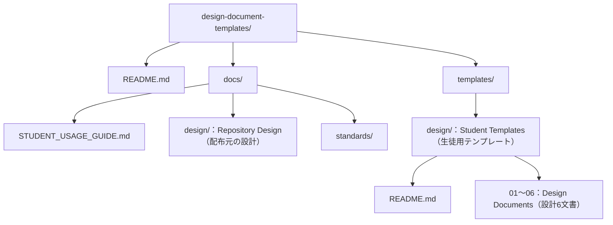
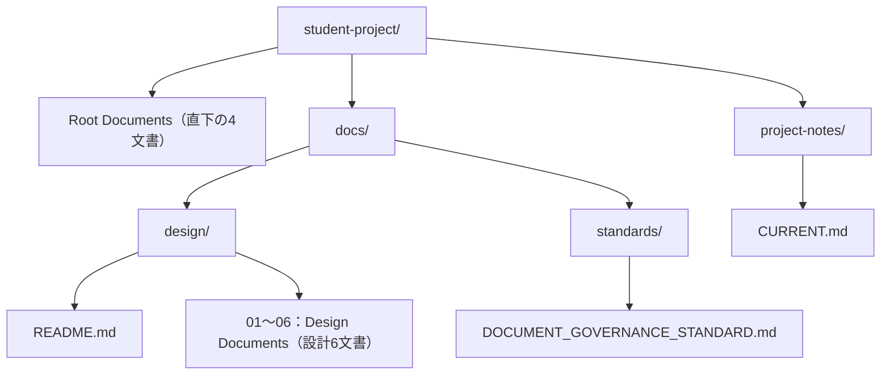

# Student Usage Guide（生徒向け使用説明書）

<!-- Document Info（文書情報） -->
| Item（項目） | Value（値） |
|---|---|
| Document ID（文書ID） | DDT-STUDENT-GUIDE-001 |
| Version（バージョン） | 0.2 |
| Status（ステータス） | Draft |
| Created Date（作成日） | 2026-10-09 |
| Last Updated（最終更新日） | 2026-10-09 |
| Owner（管理者） | Takashi Oikawa |
| Related Documents（関連文書） | `/README.md` / `/CONSTITUTION.md` / `/AGENTS.md` / `/CHANGELOG.md` / `/docs/standards/DOCUMENT_GOVERNANCE_STANDARD.md` / `/docs/NEW_REPOSITORY_SETUP_GUIDE.md` / `/templates/design/README.md` |

Repository Path（リポジトリ内の配置）：`docs/STUDENT_USAGE_GUIDE.md`

## 1. Start Here（最初に読む説明）

この説明書は、設計書のテンプレートを自分のプロジェクトへ配置し、自分が利用するAIと相談しながら設計・開発を進めるためのものです。授業の課題文、先生の指示、自分のプロジェクトの最新文書を組み合わせて使います。

**最初に取得する設計テンプレートは、配布元の `templates/design/` にある7文書です。自分のプロジェクトでは `docs/design/` に置きます。**

次の用語を使います。

| Term（用語） | Meaning（意味） |
|---|---|
| Repository（リポジトリ） | プロジェクトのファイルと変更履歴を管理する場所 |
| Root（ルート） | リポジトリの最上位のフォルダ |
| Directory（ディレクトリ） | フォルダ。`docs/design/` は `docs` の中にある `design` フォルダ |
| Template（テンプレート） | 自分のプロジェクトに合わせて記入する、未記入の文書 |
| Canonical Document（正本文書） | そのプロジェクトで正式に管理する、最新の基準文書 |
| Governance（管理ルール） | AIの作業範囲、承認、文書更新、確認方法などを定めるルール |

### 1.1 Usage Routes（利用する手順）

先生が指定した授業の進め方に合わせて、次の手順を使います。生徒であることを理由に、AIがRepository Purposeを自動的に `LEARNING` にしてはいけません。

| Route（手順） | Use Case（使う場面） | First Action（最初にすること） |
|---|---|---|
| A：Design Exercise（設計書の演習） | 設計テンプレートを使って、要求整理や設計書作成を練習する | 7文書を配置し、§7.1の指示文を使う |
| B：Governed Development（管理ルールを導入した開発） | 先生が管理ルールを導入・確認した、自分のプロジェクトで開発する | 自分の `AGENTS.md` と現在地点を確認し、§6.2・§7.2を使う |
| LEARNING Profile（学習用プロファイル） | 先生がPurposeを明示的に `LEARNING` と確定した | §6.3の読み込み対象を使う |

Aで7文書を置いたことだけでは、管理ルール一式を導入したことにはなりません。Bの初回導入は先生が用意した手順に従います。本書は、既存リポジトリへ管理ファイルを一括コピーする手順を定めません。

## 2. Document Roles（文書の役割）

### 2.1 Governance Documents（管理文書）

今回の5文書は、次の役割を持ちます。Bでは、原則として**自分のプロジェクトに配置された文書**をAIに読ませます。

| File（ファイル） | Role（役割） | When to Read（読む場面） | Handling（扱い） |
|---|---|---|---|
| `CONSTITUTION.md` | 全体の約束。誰が決め、AIがどこまで作業できるか、何を確認して完了とするかを定める | Bの開始時・再開時にAIが読む。人も承認と作業範囲のルールを確認する | 中央管理コピー。自分のプロジェクト用に独自編集しない |
| `AGENTS.md` | AIの作業手順。読む文書の順序、現在地点の確認、矛盾があるときの対応などを定める | BでAIが最初に読む。新しいAIや会話へ切り替えたときも読む | 中央管理コピー。AIの人格設定を書く場所ではない |
| `CHANGELOG.md` | 自分のプロジェクトで実際に行った変更の履歴 | 文書・実装の変更前に関連履歴を確認し、変更後に実施内容を記録する | 自分の履歴として管理する。配布元の履歴を持ち込まない。LEARNINGでは必須ではない |
| `docs/standards/DOCUMENT_GOVERNANCE_STANDARD.md` | Markdown文書の共通ヘッダー項目、表記、文書検査のルール | 管理文書を新規作成・編集するとき、検査結果を確認するときに参照する | 配布コピーを独自編集しない。設計書の内容や版数の全ルールを、この文書だけで判断しない |
| `docs/NEW_REPOSITORY_SETUP_GUIDE.md` | 新しいリポジトリを作り、管理ルールを初期配置する手順 | 新規作成時に先生と確認する | 日常のAI利用手順とは別。既存リポジトリへの移行手順ではない。非公開の配布元を使う部分は先生が準備する |

`CONSTITUTION.md`、`AGENTS.md`、文書標準は「作業のルール」、`CHANGELOG.md` は「実施したことの履歴」、新規作成ガイドは「環境を準備する手順」です。

### 2.2 Project Entry and State（プロジェクトの入口と現在地点）

AIが作業を再開するためには、次の文書も使います。

| File（ファイル） | Role（役割） | What to Record（記録する内容） |
|---|---|---|
| 自分のルート `README.md` | プロジェクトの入口 | 何を作るか、目的、使い方、関連文書への案内 |
| 自分の `project-notes/CURRENT.md` | 作業の現在地点 | Purpose、確認できた完了項目、現在の作業、次の作業、阻害要因 |
| 自分の `project-notes/DECISIONS.md`（必要な場合） | 継続して管理する判断の記録 | 判断内容と理由。関連Decisionを指定された場合などに読む |

`CURRENT.md` は「次のAIに渡す引き継ぎメモ」と考えてください。配布元の `CURRENT.md` は配布リポジトリの状態を表します。自分の課題の現在地点としてコピーしてはいけません。

`CURRENT.md` は標準の運用文書ですが、必須Governance文書10件には加えません。不在や初期の未記入だけで、Gitとの矛盾と判定しません。実際に書かれた状態がGitの実状態と食い違う場合は、編集を止めて確認します。

## 3. Design Document Roles（設計7文書の使い分け）

| File（ファイル） | Main Question（答える問い） | Content Example（記載する内容の例） |
|---|---|---|
| `README.md`（設計書フォルダ内） | この設計は何を作るためのものか | 概要、設計書一覧、全体方針、用語、担当者。詳細は個別文書へ案内する |
| `01_REQUEST_DEFINITION.md` | なぜ、誰のために作るのか | 背景・課題、利用者の要求、利用場面、制約、成功条件 |
| `02_REQUIREMENTS_DEFINITION.md` | システムは何を満たすのか | 機能一覧、性能などの条件、画面・API・データの概要、要求との対応 |
| `03_DATA_AND_SECURITY_DESIGN.md` | どのデータを、誰が、どう扱うのか | データの関係・テーブル、閲覧や更新の権限、個人情報、認証・通信・保存の設計 |
| `04_UI_AND_FLOW_DESIGN.md` | 利用者がどの画面で、どう操作するのか | 画面項目、画面遷移、入力の確認、エラー表示、操作の流れ |
| `05_ARCHITECTURE_DESIGN.md` | システムをどの構成で実現するのか | 構成図、採用技術と理由、モジュール、API詳細、環境、構成上の障害対策 |
| `06_OPERATION_AND_HANDOFF.md` | どう確認し、引き継ぎ、運用するのか | テスト方針、受け入れ基準、公開手順の概要、障害後の対応、実装への注意事項 |

例えば「ログインした利用者だけが自分の記録を見られる」という条件は02、権限や保存方法の設計は03、画面と操作の設計は04、構成やAPIの設計は05、確認するテストは06へ記載します。同じ条件を別々に決め直すのではなく、参照関係を保ちます。

01で目的を整理し、02で必要な機能を決め、03〜05で具体化し、06で確認・引き継ぎ方法を整理します。設計書のREADMEは、全体がつながるように随時更新します。この順序は記入の目安です。BでAIが開始時に読む順序は§6.2に従います。

## 4. Directory Structure（フォルダ構成）

### 4.1 Distribution Repository（配布元の構成）

次は、この説明書を含む配布リポジトリの主要な構成です。`docs/design/` は配布リポジトリ自体の設計、`templates/design/` は生徒が取得するテンプレートです。



図では管理用のルート文書、作業メモ、検証資産などを省略しています。生徒が取得する7文書は§5.1の表で確認します。

### 4.2 Student Project（自分のプロジェクトの構成）

次はBを使う場合の主要な構成です。末尾が `/` の枠はフォルダです。直下の4文書と設計6文書は、図を読みやすくするため、それぞれ1枠にまとめています。



`student-project` は説明用の名前です。自分のリポジトリ名へ読み替えます。コード、テスト、画像、検証資産の配置は次の表でも確認します。

| Path（パス） | Content（内容） | Requirement（扱い） |
|---|---|---|
| `/README.md` | 自分のプロジェクトの入口 | Aでは課題説明などと合わせて用意。Bの新規作成手順、LEARNINGでも使用する |
| `/CONSTITUTION.md` | 先生が導入した管理ルール | B・LEARNINGの必須文書 |
| `/AGENTS.md` | 先生が導入したAIの作業手順 | B・LEARNINGの必須文書 |
| `/CHANGELOG.md` | 自分の変更履歴 | Bの必須文書。LEARNINGでは必須ではない |
| `/docs/design/README.md` と01〜06 | 自分の設計書7文書 | Aの演習対象、Bの必須文書。LEARNINGでは必須ではない |
| `/docs/standards/DOCUMENT_GOVERNANCE_STANDARD.md` | 文書作成時の参照用コピー | 先生が指定した標準の配置に従う。必須Governance文書10件とは別 |
| `/project-notes/CURRENT.md` | 自分の現在地点 | 標準の運用文書 |
| `/project-notes/DECISIONS.md` | 判断の記録 | 必要な場合。存在するものを不要と判断して削除しない |
| `/scripts/validate-docs.py` | Markdown文書検査 | Bの必須検証資産。LEARNINGでは必須ではない |
| `/.github/workflows/validate-docs.yml` | GitHub上で文書検査を実行する設定 | Bの必須検証資産。LEARNINGでは必須ではない |
| `/docs/design/screenshots/thumbnail/` | 設計書README用の小さい代表画像 | 画像を使用する場合 |
| `/docs/design/screenshots/full/` | 04で説明する詳細画像 | 画像を使用する場合 |
| コード・テストのフォルダ | 実装と検証のファイル | 自分の設計と作業指示で指定した配置を使う |

Aでは設計7文書の配置が中心です。この図の管理文書や検証資産を、配布元から独自判断で追加する必要はありません。

ルートの `README.md` と `docs/design/README.md` は別のファイルです。前者はプロジェクト全体の入口、後者は設計書群の入口です。

## 5. Obtain and Initialize（取得・初期記入）

### 5.1 Copy Mapping（コピーするファイルと保存先）

先生が案内した公開版または配布教材から、次の7文書を取得します。同じ配布版の7文書をセットで使い、取得した版やコミットが案内されている場合は控えます。

| Source in Distribution Repository（配布元） | Destination in Your Project（自分の保存先） |
|---|---|
| `templates/design/README.md` | `docs/design/README.md` |
| `templates/design/01_REQUEST_DEFINITION.md` | `docs/design/01_REQUEST_DEFINITION.md` |
| `templates/design/02_REQUIREMENTS_DEFINITION.md` | `docs/design/02_REQUIREMENTS_DEFINITION.md` |
| `templates/design/03_DATA_AND_SECURITY_DESIGN.md` | `docs/design/03_DATA_AND_SECURITY_DESIGN.md` |
| `templates/design/04_UI_AND_FLOW_DESIGN.md` | `docs/design/04_UI_AND_FLOW_DESIGN.md` |
| `templates/design/05_ARCHITECTURE_DESIGN.md` | `docs/design/05_ARCHITECTURE_DESIGN.md` |
| `templates/design/06_OPERATION_AND_HANDOFF.md` | `docs/design/06_OPERATION_AND_HANDOFF.md` |

保存先に記入済みの設計書がある場合は上書きしません。先生に確認し、必要な変更だけを既存の設計へ反映します。

配布元のルートREADME、`CHANGELOG.md`、`project-notes/CURRENT.md`、記入済みの `docs/design/` は、自分のプロジェクトの説明・履歴・設計としてコピーしません。配布リポジトリ全体をそのまま自分の開発プロジェクトにする操作も、この7文書の取得手順には含みません。

### 5.2 Initialize Your Documents（自分の文書として初期化する）

1. 自分のルートREADMEまたは課題文に、作るもの、対象者、課題の条件を整理します。
2. 設計7文書を指定の場所へ置きます。
3. 先生の初期化方針に従って、文書ID、管理者、作成日、最終更新日、版数、状態を自分の文書として設定します。テンプレートの管理者名や過去の日付を、自分の作成実績として残しません。
4. `（記入欄）` を、自分のプロジェクトの情報へ置き換えます。未決の内容は、決定済みとして埋めません。
5. 設計書READMEの一覧にあるVersion・Status・Ownerを、個別文書の情報と一致させます。
6. 自分の図、画像、参照先を用意し、リンクが利用先で成立するか確認します。

AIが案を作成したことだけで `Approved` にはしません。承認者と承認手順は授業の指示に従います。設計文書固有の版数・状態・履歴の扱いは、先生が提供する `DESIGN_DOCUMENT_STANDARD.md` と `DOCUMENT_HISTORY_RULE.md` の参照内容を確認します。非公開の参照先を読めない場合は、AIにルールを推測させず、先生が提供する説明または参照用コピーを使います。

現行の設計文書標準では、`0.x` は草稿、`1.0` は初回承認版です。Draftの設計だけを基準にコード実装を始めません。設計を相談・記入する段階と、承認済み設計を実装する段階を区別します。文書の版と、アプリのリリース版は別に管理します。

### 5.3 Links and Images（リンクと画像）

テンプレートの `../../CHANGELOG.md` は、自分のリポジトリのルートCHANGELOGへの参照です。7文書だけを取得してもCHANGELOG本体は付いてきません。

Bでは、自分のCHANGELOGへつながることを確認します。AやLEARNINGでCHANGELOGを使わない場合は、先生の指示に合わせて**自分のコピー**の履歴参照を整えます。授業の記録先へ変更するか、該当しない旨を記載し、配布元の履歴を代用しません。

テンプレート内の画像パスは記入例です。画像ファイルを準備し、画像名とリンク先を自分の内容へ変更します。使わない画像例は、適用しない理由などを自分の文書へ記載し、存在しない画像を完成済みとして残しません。

配布元の `templates/design/` の修正と、自分の `docs/design/` の記入は別の作業です。

## 6. Load Documents into AI（AIに読ませる文書）

### 6.1 Provide Readable Files（実際に読める形で渡す）

| AI Environment（AIの環境） | How to Provide（渡し方） | Confirmation（確認すること） |
|---|---|---|
| ブラウザで使う対話AI | 自分の最新ファイルを添付するか、AIが実際に取得できる方法で参照させる | 読めたファイル名と版数、読めなかったものを回答させる |
| Cursorなど、プロジェクト内のファイルを読めるAI | 自分のリポジトリを開き、読む相対パスを具体的に指定する | 読んだルートが自分のリポジトリであることを確認する |
| 別のAIへ切り替える場合 | 最新の文書、現在地点、今回の依頼を新しいAIへ渡す | 前のAIの記憶や古い添付だけに依存していないことを確認する |

URLやファイル名を伝えるだけで、本文を読んだことにはなりません。AIが取得できない場合は、そのファイルを添付するなど、実際に読める形で渡します。ファイル数などの制限がある場合は分割して読み込ませ、必要な文書が読めたか確認してから作業を進めます。

AIへ渡すのは自分のプロジェクトの最新ファイルです。配布元の設計書は「テンプレート」または「配布リポジトリの設計」であり、自分の確定仕様ではありません。

### 6.2 Reading Order for Route B（Bで読む順序）

自分の `AGENTS.md` の読み順を正とします。現行文書では、最初にAGENTSの手順を確認し、`CURRENT.md` がある場合は、Profile別の必須読み順より先に読みます。

| Step（順序） | File or Evidence（文書・確認資料） | Purpose（読む目的） |
|---|---|---|
| 入口 | `/AGENTS.md` | 作業手順と適用Profileを確認する |
| 事前確認 | `/project-notes/CURRENT.md`（存在する場合）とGit実状態 | 今どこまで進んでいるか、実状態と記録が食い違わないか確認する |
| 1 | `/CONSTITUTION.md` | 権限、変更範囲、確認・承認のルールを確認する |
| 2 | `/docs/design/README.md` | プロジェクトと設計全体を把握する |
| 3 | `/docs/design/01_REQUEST_DEFINITION.md` | 背景・要求・成功条件を把握する |
| 4 | `/docs/design/02_REQUIREMENTS_DEFINITION.md` | 必要な機能と条件を把握する |
| 5 | `/docs/design/03_DATA_AND_SECURITY_DESIGN.md` | データ・権限・セキュリティを把握する |
| 6 | `/docs/design/04_UI_AND_FLOW_DESIGN.md` | 画面と操作を把握する |
| 7 | `/docs/design/05_ARCHITECTURE_DESIGN.md` | 構成と技術方針を把握する |
| 8 | `/docs/design/06_OPERATION_AND_HANDOFF.md` | 確認・運用・引き継ぎ方針を把握する |
| 9 | 今回の対象機能の仕様正本（指定されている場合） | どの機能仕様に従うか確認する |
| 10 | 承認済み作業指示書 | 今回の変更対象・作業・確認方法を確認する |
| 11 | 関連コード | 実装の実態を確認する |
| 12 | 関連テスト | 何を検証できるか確認する |

Git実状態は、作業できる環境のAIがリポジトリルート、ブランチ、HEAD、remoteの状態、未コミット差分、最新コミットなどを確認します。ブラウザAIがGitを直接確認できない場合は、Cursorなどが取得した確認記録を渡します。記録がなければ、確認済みとは扱いません。

変更前には、対象文書のVersion・Last Updated・Git履歴・CHANGELOGも確認します。ルートREADMEはプロジェクトの入口として、本書と文書標準は利用・編集時の参考として参照します。

`DECISIONS.md` は毎回全文を必須にせず、CURRENTや作業指示が指定する判断、構成・運用・配布を変更する場合など、関連する範囲を読みます。

新規設計の相談段階で、機能別仕様、承認済み実装指示、コード、テストがまだ存在しない場合は、その状態を明記します。存在しないものを読んだと報告したり、実装指示を自動的に承認済みにしたりしません。実装を始める前には、その作業に必要な仕様と指示を揃えます。

### 6.3 Reading Order for LEARNING（LEARNINGで読む順序）

先生がPurposeを `LEARNING` と確定した場合は、AGENTSを確認し、CURRENTがあれば先に読んだ後、次を読みます。

1. 自分の `CONSTITUTION.md`
2. 自分のルート `README.md`
3. 関連する `DECISIONS.md`（必要な場合）
4. 今回の対象教材

LEARNINGでは、設計7文書、CHANGELOG、文書検査用スクリプト・workflowを一律の必須条件にしません。設計書を教材として使う場合は、課題が指定した文書を対象教材として追加します。

### 6.4 Inputs by AI Role（AIの役割ごとに渡すもの）

| Role（役割） | Additional Inputs（共通文書に加えて渡すもの） | Expected Output（求める結果） |
|---|---|---|
| Design Assistant（設計を相談するAI） | 課題文、利用者の希望、制約、今回決めたいこと | 要求の整理、設計案、確認が必要な質問、実装担当へ渡す指示案 |
| Implementation Assistant（実装するAI） | 承認済みの具体的な作業指示、変更可能なファイル、確認方法 | 指定範囲の変更、実差分、検証結果、残っている問題 |
| Review Assistant（確認するAI） | 変更後の実ファイル、実差分、判断基準となる仕様、検証結果 | 仕様との一致、不足・矛盾、修正が必要な箇所 |

同じAIを使う場合も、今回の役割を指定します。実装AIの「完了」という文章だけを別のAIへ渡して、レビュー完了と判断しません。

## 7. Starter Prompts（最初にAIへ渡す指示文）

`<...>` を自分の情報に置き換えて使います。授業で示されたルールがある場合は、併せて渡します。

### 7.1 Design Exercise Prompt（Aの設計演習用）

```text
私は授業で、自分のプロジェクトの設計書を作成します。
今回の役割は設計相談です。まず資料を読み、内容を整理してください。

Project Name（プロジェクト名）：<自分のプロジェクト名>
Assignment（課題）：<今回の課題文または添付名>
Goal（今回の目的）：<例：01の背景・課題・成功条件を整理する>

読み込み対象は、自分のプロジェクトの次の資料です。
- README.md（用意している場合）
- 課題文・先生の指示
- docs/design/README.md
- docs/design/01_REQUEST_DEFINITION.md
- docs/design/02_REQUIREMENTS_DEFINITION.md
- docs/design/03_DATA_AND_SECURITY_DESIGN.md
- docs/design/04_UI_AND_FLOW_DESIGN.md
- docs/design/05_ARCHITECTURE_DESIGN.md
- docs/design/06_OPERATION_AND_HANDOFF.md

未記入のテンプレートと、私が決めた内容を区別してください。
不明な利用者、機能、期限、技術、承認実績を推測で埋めないでください。
読むことができたファイルと読めなかったものを示し、
今回の設計に必要な確認から始めてください。
ファイルの直接編集やコードの実装は、この依頼には含めません。
```

### 7.2 Governed Project Prompt（Bのプロジェクト開始用）

この指示文は、先生が管理ルールの導入を確認した、LEARNING以外の現行Profileに使います。LEARNINGでは§6.3の読み込み対象へ切り替えます。

```text
次の私のプロジェクトを対象に、今回の作業の準備をしてください。

Repository（対象）：<自分のリポジトリURLまたは名前>
Local Directory（ローカル保存先）：<自分の保存先。ブラウザAIでは未接続と明記>
Purpose（先生が確認した値）：<確認済みの値>
Role（今回の役割）：<設計相談／実装／レビュー>
Task（今回の依頼）：<具体的な依頼>

最初に、このプロジェクトのAGENTS.mdを読んでください。
project-notes/CURRENT.mdがあれば、必須文書の読み順より先に読み、
Git実状態または提供された最新の確認記録と照合してください。

その後、AGENTS.mdの順序に従い、次を読んでください。
- CONSTITUTION.md
- docs/design/README.md
- docs/design/01_REQUEST_DEFINITION.md
- docs/design/02_REQUIREMENTS_DEFINITION.md
- docs/design/03_DATA_AND_SECURITY_DESIGN.md
- docs/design/04_UI_AND_FLOW_DESIGN.md
- docs/design/05_ARCHITECTURE_DESIGN.md
- docs/design/06_OPERATION_AND_HANDOFF.md
- 対象機能の仕様正本：<指定されたパス／相談段階で未作成>
- 承認済み作業指示書：<指定された資料／相談段階で未作成>
- 関連コード・テスト：<対象パス／未実装>

編集前には関連するCHANGELOG、文書の版・更新日・Git履歴を確認し、
必要な文書標準、ルートREADME、関連Decisionも参照してください。

読めた文書のパスと版数、読めなかった文書、適用するPurpose、
今回の対象範囲を簡潔に示してください。
Gitを確認できない場合は未確認と明記してください。
この依頼は準備と確認です。ここでは編集、commit、pushは行いません。
```

### 7.3 Reading Confirmation（読み込み確認の例）

AIの読み込み確認は、次のような情報があれば確認できます。実際の値を記載させます。

| Item（項目） | Expected Information（確認する情報） |
|---|---|
| Target Repository（対象リポジトリ） | 自分のプロジェクト名・ルート |
| Purpose（目的） | 人が確認した値。AIの推測ではない |
| Read Documents（読んだ文書） | パス、Document IDとVersion、標準文書ではSTANDARD_VERSIONなど |
| Unread Documents（読めなかった文書） | パスと理由。未作成と取得失敗を区別する |
| Current State（現在地点） | 今回扱う作業と次の作業。Git確認の有無も区別する |
| Work Scope（作業範囲） | 今回変更できるものと、まだ承認されていないもの |

## 8. Work with AI（AIと設計・実装を進める）

### 8.1 Write Design Documents（設計書を記入する）

一度にすべて完成させようとせず、今回の文書・節と、決めたい内容を指定します。

```text
今回の対象は docs/design/01_REQUEST_DEFINITION.md の5.1と5.5です。
課題文と私の説明から、背景・課題・成功条件の記入案を作成してください。
決定済みの内容、不明な内容、提案を区別し、
不明なことは確認してから記入してください。
ほかの設計書への影響がある場合は、変更候補として示してください。
```

対象外の章も、不要だからという理由だけで消しません。該当しない場合は、適用しない理由を記載します。01の成功条件が02の要件、03〜05の設計、06の確認方法につながっているか、人とAIで確認します。

Bでは、仕様を決める設計段階と、決めた仕様を実装する段階を区別します。既存の確定・未決・却下の分類やID管理がある場合、そのルールに従います。実装AIに新しい仕様IDを採番させたり、確定内容を独自変更させたりしません。

### 8.2 Request Implementation（実装を依頼する）

実装を依頼するときは、少なくとも次を具体的にします。

- 基準とする設計・機能仕様と、その版。
- 今回実装することと、変更するファイル。
- 変更範囲の承認者と、承認済みの作業指示。
- 合否を判断する確認方法。
- 実差分と確認結果の提出方法。

「設計書を読んで、よい感じに作って」だけでは作業範囲が決まりません。AIが必要な追加変更を見つけた場合は、承認済みの範囲へ勝手に加えず、候補として報告させます。

### 8.3 Review the Result（結果を確認する）

変更後の実ファイルと差分を使い、仕様との一致を確認します。未追跡の新規ファイルは通常の `git diff` に本文が含まれないため、全文も提出対象にします。

確認担当へは「作業報告」だけでなく、変更した文書・コード、実差分、確認コマンドの結果、未実施の確認、残っている問題を渡します。Bでは設計担当の差分レビューを経て、明示指示の範囲でcommit・pushなどを行います。

## 9. Resume and Handoff（再開・別のAIへの引き継ぎ）

### 9.1 End-of-Session Record（作業終了時の記録）

CURRENTを運用している場合は、実際に確認したことを記録します。

| Field（項目） | Content（記録内容） |
|---|---|
| Purpose（目的） | 人が確定したRepository Purpose |
| Completed（完了） | 実施・確認できたこと。確認資料や結果も必要に応じて記載する |
| Current（現在） | 現在進めている作業・確認段階 |
| Next（次） | 次に着手する具体的な作業 |
| Blockers（阻害要因） | 作業を妨げている未解消の問題 |
| Related Decisions（関連Decision） | 関係する既存の判断記録。存在しない番号は作らない |

CHANGELOGを使うプロジェクトでは、実施した変更を履歴へ記録します。「案を作った」「レビュー済み」「commit済み」「push済み」「公開済み」はそれぞれ別の状態です。予定を完了欄に書きません。

### 9.2 Resume Prompt（再開するときの指示文）

```text
このプロジェクトの作業を再開します。
今回の対象：<自分のリポジトリ>
今回の役割：<設計相談／実装／レビュー>
今回の依頼：<具体的な依頼>

前の会話だけを基準にせず、最新の文書を読み直してください。
管理ルールを導入したプロジェクトでは、AGENTS.mdの手順に従い、
CURRENT.mdがあれば先に読んで実状態と照合し、
確定したPurposeの必須文書・今回の関連資料を確認してください。

添付または参照資料：
- 最新の管理ルールと設計文書・課題文
- CURRENT.md（使用している場合）
- 今回の作業指示・機能仕様
- 作業中の差分と変更後ファイル（ある場合）
- 最新のGit確認・検証結果（別の環境から引き継ぐ場合）

何を確認できたか、何が未確認かを区別して、今回の開始地点を示してください。
```

## 10. Verification（確認方法）

Bでは、先生が導入した検証資産がある環境で、文書変更後にリポジトリルートから確認します。

```bash
python3 scripts/validate-docs.py
git diff --check
git status --short
```

| Check（確認） | What It Shows（分かること） | Additional Review（別に確認すること） |
|---|---|---|
| `validate-docs.py` | 検査対象Markdownに必須ヘッダーの項目名があるか | 項目の値、設計の正しさ、リンク、版数の一致、承認実績 |
| `git diff --check` | 差分に含まれる空白などの問題 | 仕様と実装の一致、機能の動作 |
| `git status --short` | 変更・追加されたファイル | 各ファイルの内容と、今回の作業範囲に収まるか |

検査がPASSでも、内容のレビューや承認が済んだことにはなりません。LEARNINGではvalidatorとworkflowは必須ではなく、不在だけを理由に作業を止めません。

画像・リンク・設計書一覧の整合、課題の条件、機能の受け入れ基準などは、内容を見て確認します。

## 11. Common Questions（よくある質問）

| Question（質問） | Answer（回答） |
|---|---|
| 配布元の `docs/design/` を使えばよいですか | 自分の設計書を作るために取得するのは `templates/design/` です。配布元の `docs/design/` は配布リポジトリ自体の設計です |
| 7文書を添付すれば、AIの作業ルールも導入されますか | 設計文書の読み込みと管理ルールの導入は別です。Bでは自分の管理文書と現在地点も読み込ませます |
| AGENTSを置けば、すべてのAIが自動で読みますか | AIが自動で読んだと決めつけず、読むファイルを指定して確認します |
| 毎回、課題と関係のない全コードも渡しますか | 管理ルールが定める開始時の文書に加え、今回の対象仕様・関連コード・テストを渡します。関係のない全コードを一律には要求しません |
| 配布元で新しいテンプレートが出たら、記入済みの設計書を置き換えますか | 上書きしません。変更点を確認し、必要な内容だけを自分の設計へ反映します |
| 管理文書内の先生の名前を、自分の名前へ変更してよいですか | 自分の設計文書の管理者は初期化します。中央管理コピーの権限・管理者の記述は独自変更せず、先生が指定した導入方針に従います |

## 12. Instructor Release Preparation（先生向け公開準備）

この節は説明書を公開版へ整えるための確認事項です。2026-10-09の初期化資料を確認した時点では、配布先はPrivateの準備中で、正式承認・commit・push・生徒向け公開は完了していません。本書は初版Draftです。説明書の追加やレビュー指摘への対応と、正式承認・GitHubへの反映・公開の完了は、それぞれ区別して記録します。

### 12.1 Student Access and Authority（生徒の取得方法と権限）

説明書を公開する前に、授業で提供する利用手順を確定します。

- Aを使う場合：7文書の取得方法、課題文、設計文書の初期化・レビュー方法を提供する。
- Bを使う場合：生徒が取得・利用できる管理文書と検証資産の導入経路を用意し、完全な導入を確認する。
- LEARNINGを使う場合：先生がPurposeを確定し、LEARNING用の導入・読み込み対象を案内する。

現行CONSTITUTION・AGENTSはPurpose確定者を `Takashi Oikawa` と明記しています。この権限を授業でも維持するのか、生徒本人の権限を含む別の運用にするのかは、先生が決めます。後者を採用する場合は、中央ルールの変更・配布工程で対応し、生徒やAIにローカル書き換えを指示しません。

`project-bootstrap` と `solacom_main` は非公開のため、生徒が当然に利用できる取得先として案内しません。新規作成ガイド内のTemplate Routeやinstallerを生徒に使用させる場合は、アクセス可能な経路または先生による準備を具体的に用意します。

設計書固有の規則は `DESIGN_DOCUMENT_STANDARD.md`、履歴の規則は `DOCUMENT_HISTORY_RULE.md` が参照先です。生徒に規則を適用する範囲では、必要な説明または参照文書を提供します。非公開URLのリンクだけで提供済みとしません。

### 12.2 Repository Integration（配布リポジトリへの追加）

本書を `docs/STUDENT_USAGE_GUIDE.md` として追加し、ルートREADMEから「Student Usage Guide（生徒向け使用説明書）」へ案内します。READMEには概要とリンクを置き、詳しい使い方は本書へまとめます。

管理側の02（要件）、04（利用の流れ）、05（配置）、06（運用・引き継ぎ）に必要な参照や条件を反映し、CURRENT・CHANGELOGへ実施状態を記録します。実ファイルを確認した上で、変更対象と差分を設計担当レビューへ提出します。

この追加によって、配布用7文書の本文を独自変更したり、中央管理コピー・検証資産を書き換えたりはしません。

### 12.3 Existing Release Tasks（既存の公開前課題）

初期化報告にある、原本READMEの一覧Version 0.1と個別文書のVersion 0.2の相違は、原本側で解消して再配布する課題として残っています。本書の追加やvalidatorのPASSでは解消しません。

初期化済み17ファイルについては、提出されたレビューZIPの実ファイルと差分を設計担当が確認しました。使用説明の不足、CHANGELOGの分類、文書件数の表現などは修正対象です。説明書の追加と修正後に、改めて実差分をレビューします。正式承認、commit・push、Actions確認、公開内容の確認、生徒が取得できる状態の確認は後続工程です。

## 13. Source Basis（説明の根拠）

本書案は、提供された次の文書と、初期化報告・確認済みテンプレートに基づきます。参照元は先生側の確認資料であり、生徒が非公開の中央リポジトリへアクセスすることを前提にしません。

| Source（確認資料） | Basis（使用した内容） |
|---|---|
| `CONSTITUTION.md` STANDARD_VERSION 1.7 | 役割と権限、Profile、配置、変更統制、実差分確認 |
| `AGENTS.md` STANDARD_VERSION 1.5 | CURRENTを先に確認する手順、Profile別の読み順、履歴確認、関連Decision |
| `CHANGELOG.md` DDT-CHANGELOG-001 Version 0.1 / Draft | 配布リポジトリ固有の履歴、初期化・検証と未公開状態 |
| `DOCUMENT_GOVERNANCE_STANDARD.md` Version 1.7 / Approved | 共通ヘッダー、表示形式、検証範囲、中央管理コピー |
| `NEW_REPOSITORY_SETUP_GUIDE.md` Version 1.0 / Approved | 新規作成に限定した手順、通常経路とLEARNING経路、初期化とレビュー |
| 設計テンプレート7文書 | 各文書の章・節、記入欄、相対リンク、画像配置 |
| 初期化報告・DDT-WI-INIT-001・レビューZIP | DISTRIBUTION、管理用と配布用の分離、実ファイルと差分、7文書の配置、公開前の未完了項目 |
| 中央正本コミットの `DESIGN_DOCUMENT_STANDARD.md` Version 0.9 / Draft と `DOCUMENT_HISTORY_RULE.md` Version 2.3 / Approved | 配置、各設計文書の責務、版・状態・履歴の参照規則 |

設計テンプレートは、対象リポジトリの基準コミット `0aa4e9e3af77688c6485035eb23b98061cd740d0` の `docs/design/` と、提出されたレビューZIPの配布用7文書を確認しています。ZIPの17ファイルのSHA-256・Git Blob SHAを実際の収録バイトから再計算し、7文書の変更前テンプレートとの一致、および10文書のdiffと変更前後本文の対応を確認しました。中央正本コミット `16c44976638b48c53ef16399b1d51217c540be0a` の7文書との一致は、初期化報告と確認済みの内容照合値を参照しています。レビューZIPは作成時点の資料であり、生徒向け公開版そのものではありません。
