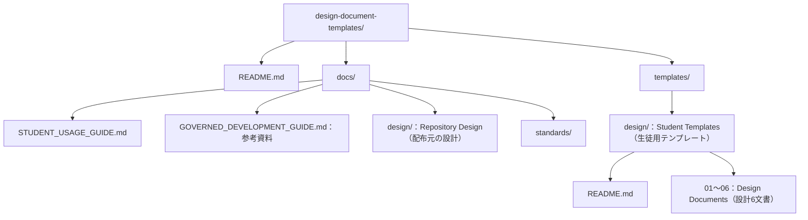

<!--
Program Name: DDT Architecture Design
Language: Markdown
Function: 管理文書と配布物の配置、および配布元との関係を定義する
Created: 2026-10-09
Last Updated: 2026-10-10
Author: Takashi Oikawa
AI: Cursor
Memo: Document ID DDT-ARCH-001。Version 0.6 / Draft。正式承認ではない
-->

# Architecture Design（アーキテクチャ設計）

<!-- Document Info（文書情報） -->
| Item（項目） | Value（値） |
|---|---|
| Document ID（文書ID） | DDT-ARCH-001 |
| Version（バージョン） | 0.6 |
| Status（ステータス） | Draft |
| Created Date（作成日） | 2026-10-09 |
| Last Updated（最終更新日） | 2026-10-10 |
| Owner（管理者） | Takashi Oikawa |
| Related Documents（関連文書） | README.md / 02_REQUIREMENTS_DEFINITION.md / 03_DATA_AND_SECURITY_DESIGN.md / 06_OPERATION_AND_HANDOFF.md / [../STUDENT_USAGE_GUIDE.md](../STUDENT_USAGE_GUIDE.md) / [../GOVERNED_DEVELOPMENT_GUIDE.md](../GOVERNED_DEVELOPMENT_GUIDE.md) |

---

## Table of Contents（目次）

1. [Purpose（目的）](#1-purpose目的)
2. [Scope（対象範囲）](#2-scope対象範囲)
3. [Out of Scope（対象外範囲）](#3-out-of-scope対象外範囲)
4. [Assumptions（前提条件）](#4-assumptions前提条件)
5. [Definition Details（定義内容）](#5-definition-details定義内容)
6. [Open Issues（未決事項）](#6-open-issues未決事項)
7. [Handoff to Detail Design（詳細設計への引き継ぎ）](#7-handoff-to-detail-design詳細設計への引き継ぎ)

---

## 1. Purpose（目的）

本文書は、管理文書と配布物の配置、および配布元との関係を定義する。

---

## 2. Scope（対象範囲）

`solacom_main` の中央テンプレ正本、この Repository の `templates/design/`、生徒の `docs/design/`、この Repository の管理用 `docs/design/`、`docs/STUDENT_USAGE_GUIDE.md`、および参考資料 `docs/GOVERNED_DEVELOPMENT_GUIDE.md` の関係を対象とする。

---

## 3. Out of Scope（対象外範囲）

- 新しいアプリ、サーバー、DB、Web サイト、CI 設定の追加
- 中央標準の再設計
- 既存の標準管理コピーの変更

---

## 4. Assumptions（前提条件）

- 中央正本の確認済みコミットは `16c44976638b48c53ef16399b1d51217c540be0a` である。
- 既存の Python validator と GitHub Actions を使用する。
- 新しい CI 設定は追加しない。
- 既存の標準管理コピーは維持する。

---

## 5. Definition Details（定義内容）

### 5.1 System Architecture Diagram（システム構成図）

追加後の配布元の主要なフォルダ構成は次のとおりである。管理用 `docs/design/` と配布用 `templates/design/` を区別する。使用説明書では利用先の7文書配置だけを示す。本図は管理側で配布元の構成を示す。利用先で設定ファイルがある場合とない場合の構成は [../GOVERNED_DEVELOPMENT_GUIDE.md](../GOVERNED_DEVELOPMENT_GUIDE.md) の共通前提に示す。本節の図は、その利用先の構成図ではない。

中央正本から利用先までの対応は次のとおりである。生徒側のフォルダ構成図は [../STUDENT_USAGE_GUIDE.md](../STUDENT_USAGE_GUIDE.md) の §4 を参照する。中央の非公開配布元を生徒の必須読込み先にしない。

| Source（対応元） | Destination（対応先） |
|---|---|
| `solacom_main/docs/standards/templates/design/` | 配布元 `templates/design/` |
| 配布元 `templates/design/` | 生徒の `docs/design/` |

### 5.2 Technology Stack and Rationale（技術スタック・採用理由）

版数の固定値は作らない。

| Type（種別） | Technology（採用技術） | Version（バージョン） | Rationale（採用理由） |
|---|---|---|---|
| Language（言語） | Markdown | 未指定。固定値は作らない。 | 配布形式は、この工程では Markdown ファイルである。 |
| Framework（フレームワーク） | 追加しない | — | 対象外。理由: 新しいアプリとフレームワークは追加しない。 |
| Database（DB） | 追加しない | — | 対象外。理由: DB は追加しない。 |
| Infrastructure（インフラ） | GitHub / Git | 未指定。固定値は作らない。 | 文書の保管と閲覧に、既存の GitHub と Git を使う。 |
| Other（その他） | 既存の Python validator と GitHub Actions | 未指定。固定値は作らない。 | 既存の `scripts/validate-docs.py` と `.github/workflows/validate-docs.yml` を使う。新しい CI 設定は追加しない。 |

### 5.3 Module Structure and Layer Design（モジュール構成・レイヤー設計）

アプリのレイヤー設計は対象外。理由: 新しいアプリは追加しない。配置は次のとおりである。

- `docs/design/` は、この Repository の管理用設計正本である。
- `docs/GOVERNED_DEVELOPMENT_GUIDE.md` は、7文書の記載先と任意の設定ファイルの参考資料である。使用説明書の指示例を全文では再掲しない。
- `docs/STUDENT_USAGE_GUIDE.md` は、生徒向け使用説明書である。文書の役割、取得と配置、初期化、設定なしの記入・仕様変更・実装を説明する。配布テンプレート7文書には含めない。
- `templates/design/` は、配布コピーである。
- `CONSTITUTION.md`、`AGENTS.md`、`docs/standards/DOCUMENT_GOVERNANCE_STANDARD.md` は、既存の標準管理コピーとして維持する。利用先への導入は任意であり、この配布元の必須管理資産とは別である。
- `scripts/validate-docs.py` と `.github/workflows/validate-docs.yml` は、既存の検証資産として維持する。利用先で設定ファイルが無いことを、この配布元の検証資産の削除理由にしない。

### 5.4 External Integration and API Design（外部システム連携・API設計方針）

独自 API の詳細仕様は対象外。理由: 独自 API は追加しない。

| Integration Target / API Name（連携先 / API名） | Method（連携方式） | Purpose / Overview（用途・概要） |
|---|---|---|
| GitHub | Git、および GitHub のファイル閲覧 | 文書の保管と閲覧。既存の GitHub Actions を使う。独自 API は追加しない。 |

### 5.5 Scalability and Fault Tolerance（スケーラビリティ方針・障害対策）

| Aspect（観点） | Design Details（設計内容） |
|---|---|
| Scaling Policy（スケーリング方針） | 対象外。理由: 新しいサーバーとアプリは追加しない。 |
| Redundancy（冗長化） | 対象外。理由: 新しいサーバーとアプリは追加しない。 |
| Failover（フェイルオーバー） | 対象外。理由: 新しいサーバーとアプリは追加しない。 |
| Other Fault Tolerance（その他耐障害設計） | 対象外。理由: 新しいサーバーとアプリは追加しない。 |

### 5.6 Infrastructure and Environment（インフラ・環境構成）

| Environment（環境） | Configuration / Resources（構成・リソース概要） |
|---|---|
| Development（開発） | ローカル作業ディレクトリ。 |
| Staging（ステージング） | 対象外。理由: ステージング環境は追加しない。 |
| Production（本番） | この準備工程では GitHub 上の Private repository である。Public への変更は後続工程である。 |

---

## 6. Open Issues（未決事項）

本文書の範囲に未決仕様はない。理由: 本指示で指定した配置と使用技術は確定事項として本文に記載した。追加しないものに版数を付けないことは、固定値を作らない確定事項であり、未決仕様ではない。テンプレートの空の TBD 行は、本 Repository の未決事項ではない。

| ID | Open Issue（未決事項） | Owner（担当者） | Due Date（期限） | Status（ステータス） |
|---|---|---|---|---|
| — | 未決仕様はない。理由は本節本文のとおり。 | — | — | — |

---

## 7. Handoff to Detail Design（詳細設計への引き継ぎ）

アプリ実装への引き継ぎは対象外。理由: 新しいアプリ、サーバー、DB、Web サイト、CI 設定は追加しない。更新と確認の順は [06_OPERATION_AND_HANDOFF.md](./06_OPERATION_AND_HANDOFF.md) に記載する。
